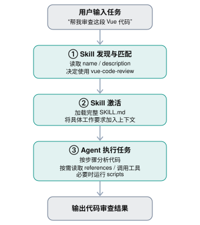

如果你的目标是学习如何编写 AI Agent Skill（技能），并进一步理解 Skill 的底层原理，甚至自己实现一个 Skill 加载和执行框架，目前已经有比较成熟的开源资料可以参考。

我建议从三个层次学习：

1. 规范层：Skill 的目录结构、`SKILL.md` 格式、编写规则。
2. 实践层：学习 Anthropic、OpenAI 等提供的真实 Skill。
3. 原理层：研究 Agent 如何发现 Skill、选择 Skill、加载说明并执行脚本。

## 一、最值得学习的 5 个开源项目

[Agent Skills Overview - Agent Skills](https://images.openai.com/static-rsc-4/kpu3kxDJkX3O3kMhj4fJQoEUeQO6pDD9W-8joRZeayE-FC_lThBvUz_am-BMClB9_JU9c38qlrN9LgM-J4knWKCFy4W0v1OAO6Bxd1iir4TLDI9D2ziTs2ERMmEhOdkVCqMOBIYT05Di4z7UK7V8qyTN3ue-NSN24bzsHrktsvA?purpose=inline)

1\. Agent Skills — 官方规范

适合：从零开始，理解 Skill 标准

这是首选学习资料。详细介绍 `SKILL.md`、YAML 元数据、目录结构，以及按需加载（Progressive Disclosure）机制。

[官方文档](https://agentskills.io?utm_source=chatgpt.com) · [GitHub 源码](https://github.com/agentskills/agentskills?utm_source=chatgpt.com)

[Claude](https://images.openai.com/static-rsc-4/cLHBfiXuOV35_PSb5wC1jXivsAXbOR_8j6QIuMUVJNmHhvqDTZSAjip3DZXEZE8rrigO3zrBPXPTm3OPFqtXG1oYbfxtfR2epfKwRiaR-r0auw26KWwnnPiRgtOfu6qqeScD6KjrINNkb8STcXPBIHcixXdk1xpiKuwC8UdBT_8?purpose=inline)

---

2\. Anthropic Skills — 最值得照着写的示例库

适合：学习具体写法、工程实践

包含完整模板，以及文档生成、前端设计、技术开发等不同类型的 Skill。能看到简单 Skill 和复杂 Skill 的组织方式。部分示例为源码可见，但并非全部采用开源许可证。

[GitHub 仓库](https://github.com/anthropics/skills?utm_source=chatgpt.com) · [Skill 模板](https://github.com/anthropics/skills/tree/main/template?utm_source=chatgpt.com)

[OpenAI’s New Codex AI Helps Developers Write Code Faster](https://images.openai.com/static-rsc-4/37qdCGRSsGeR_3GtYa4pemAdosEyy110AX8z3oyou0YLDMeOX5tNExynLqkgbJFFJs_yUorCYkTIMco6Qq6B5su9I7Ag6cgBHRXy63hrpAZCtg2656BUCbMsIkCB2kuhdemVtAes9W9Bv8ZA0_i6LgAu1D5_SiV7Q68xx1v0JMg?purpose=inline)

---

3\. OpenAI Skills — Codex Skill 示例库

适合：使用 Codex、学习开发工作流

可以研究 GitHub PR、代码审查、自动化开发等工作流 Skill。需要注意，该仓库已标记为弃用，新的 Codex 示例正在迁往 OpenAI Plugins 仓库。

[GitHub 仓库（历史示例）](https://github.com/openai/skills?utm_source=chatgpt.com)

[agentskills/skills-ref/pyproject.toml at main · agentskills/agentskills · GitHub](https://images.openai.com/static-rsc-4/JtXFA8TMpoBX9wRgUkzT72uiM-Lmr1GU5i9pa73dk7ftI01-83024kSdMKp1lBpJCLlmjGyr4H3yOM2kI3eZuPa7nukkq9GOIUSAuqNCN-t3GAa6qrM6JhT2zbmg-r7EXlgRZmvKEx0Vrz9x9eloBaedS6XWEKQM_JYiM0MqEy8?purpose=inline)

---

4\. OpenSkills SDK — 研究底层实现

适合：理解 Skill 加载器，自己实现框架

提供 Python 源代码，展示自动发现 Skill、元数据加载、LLM 匹配、引用文件加载和脚本执行等机制。非常适合研究实现原理，但不是 Agent Skills 的官方参考实现。

[GitHub 仓库](https://github.com/LingyiChen-AI/OpenSkills?utm_source=chatgpt.com)

[plugins/plugins/superpowers/CODE_OF_CONDUCT.md at main · openai/plugins · GitHub](https://images.openai.com/static-rsc-4/-k8sK_UYfmsFP-wk00yjcup0nG5NqB51BoB2MOMPziUMHR7CGvAzcSpmC_z6pTiBldEkog9u1TDj250WLdgZubt7sPKHU8QLaoodUpxlDHcRgBYxUIUoNlnTDJx78l7l37LVM0JifDMQCYm9GL2KX9GipGLywI2-Nfn4Gwrj5Iw?purpose=inline)

---

5\. OpenAI Plugins — 新版 Codex 扩展方向

适合：研究 Skill 与 Plugin 如何组合

适合进一步学习 Skill 如何作为 Agent 扩展的一部分进行组织、分发和集成，尤其是 Skill-only Plugin。

[GitHub 仓库](https://github.com/openai/plugins?utm_source=chatgpt.com)

---

其中，前两个适合学怎么写，第四个适合研究怎么实现。官方规范说明 Skill 的核心思想是通过分阶段加载元数据、完整指令和辅助资源来控制上下文开销。

## 二、Skill 的核心原理是什么？

Skill 本质上不是一个新的 AI 模型，也不必是一个可执行程序，而是一套可以被 Agent 按需加载的操作说明。

其核心是：`Markdown 指令 + 元数据 + 可选脚本/资源 + Agent 的工具执行能力`。



典型 Agent Skill 工作流程。具体发现和执行机制取决于 Agent 宿主。

这里最值得理解的是三个问题：

- Skill 如何被选中？ 通常由 Agent 根据用户任务和 Skill 的 `description` 进行语义匹配，而不是仅依靠关键词。
- 为什么要分阶段加载？ 因为 Agent 的上下文窗口有限，不应该把所有 Skill 的完整内容一次性加载进去。
- Skill 能做什么？ Skill 本身提供知识和步骤，真正读取文件、运行代码、访问网络的是 Agent 所拥有的工具和运行环境。

## 三、自己写一个 Skill 有多简单？

例如，给你的 Vue3 项目写一个代码审查 Skill，目录可以是：

```
vue-code-review/
├── SKILL.md
├── references/
│   └── vue3-rules.md
└── scripts/
    └── check.sh
```

其中最核心的 `SKILL.md`：

```

---
name: vue-code-review
description: Review Vue 3 and TypeScript code for common bugs, maintainability and performance issues. Use when reviewing Vue components or composables.
---

# Vue3 Code Review

## Workflow

1. Read the target Vue or TypeScript files.
2. Identify code correctness issues.
3. Check Vue 3 Composition API usage.
4. Check reactive state and watcher behavior.
5. Check for performance and memory leaks.
6. Report problems with file paths and line numbers.

## Reference

Read `references/vue3-rules.md` when detailed
Vue 3 conventions are needed.

## Output

For each issue include:
- Severity
- File and line
- Explanation
- Recommended fix

```

这是一个已经具备基本结构的 Skill。实际使用时，将它放到 Agent 支持的 Skill 目录，并根据宿主的规则进行发现和加载即可。

需要注意：脚本文件不会因为放在 `scripts/` 目录中就自动执行。必须由 Skill 指令明确要求，并且 Agent 具备相应的执行工具及权限。

## 四、最推荐深入阅读的两个 SKILL.md

这两个文件甚至比阅读几十个普通 Skill 更有学习价值。

- [OpenAI Skill Creator](https://github.com/openai/skills/blob/main/skills/.system/skill-creator/SKILL.md?utm_source=chatgpt.com): 专门教 Agent 如何创建 Skill。重点解释如何设计指令、组织资源、控制上下文，以及什么任务适合使用脚本。
- [Superpowers / Writing Skills](https://github.com/openai/plugins/blob/main/plugins/superpowers/skills/writing-skills/SKILL.md?utm_source=chatgpt.com): 重点介绍如何测试 Skill 是否真正有效。它借鉴 TDD 思路，先观察 Agent 在没有 Skill 时的行为，再加入指令并验证效果。

## 五、建议你的学习顺序

学习进度

0 / 6 已完成

1\. 先掌握规范

阅读 Agent Skills 的 Overview 和 Specification，理解 SKILL.md 的格式。

2\. 阅读简单实例

从 Anthropic 的 template 开始，理解 name、description 和 Markdown 指令。

3\. 自己写一个 Skill

例如 Vue3 代码审查、Spring Boot 项目检查或 GitHub PR 规范检查。

4\. 阅读复杂实例

研究 Skill 如何组织 references、scripts、assets，以及如何按需调用。

5\. 研究底层实现

阅读 OpenSkills SDK，重点看加载器、技能匹配、脚本执行与上下文管理。

6\. 动手实现迷你框架

使用 Node.js + TypeScript 实现扫描 Skill 目录、解析 YAML、匹配技能并注入 LLM 上下文。

对于你使用的 Node.js / TypeScript 技术栈，我尤其建议完成第六步。

因为只要自己实现一次 Skill 加载器，就会真正理解：

Skill 是如何将静态知识转变成 Agent 可以按需调用的工作能力的。

而且你会发现，Skill 和 MCP、Tool Calling、普通 Prompt、AGENTS.md 虽然有所关联，但它们实际上解决的是不同层次的问题。
